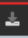
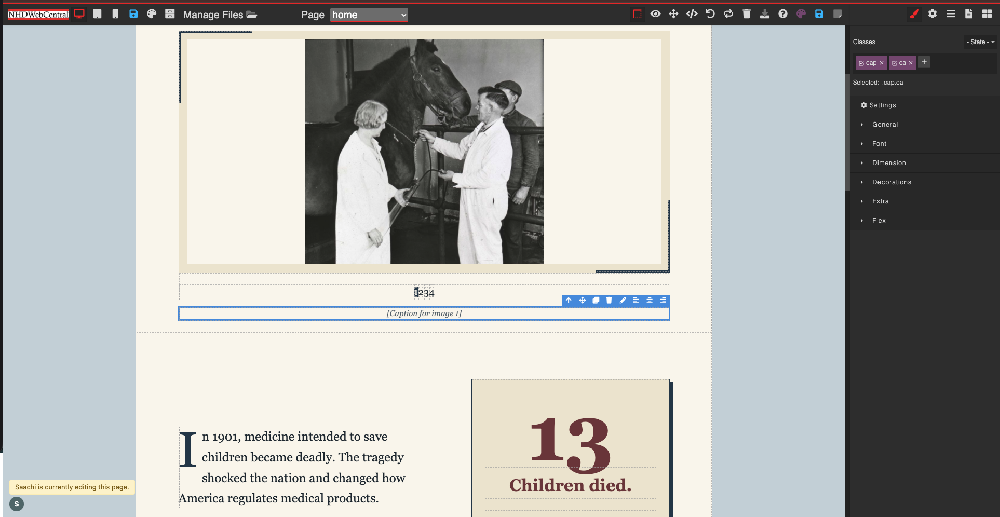

# How to put this code into the NHD editor

You don't need to know any code. You copy two files and paste them into two boxes.

## What you need

- `home.html` (everything in it, including the `<script>` part at the bottom)
- `home.css`

## Steps

1. **Open the editor.** Go to NHD WebCentral, open the site, and pick **home** in the **Page** dropdown at the top.

2. **Open the Import window.** In the toolbar at the top of the editor, click the **Import** button. It looks like a tray with a down arrow:

   

   It sits in the right half of the top toolbar, between the trash can and the question mark:

   

   A window titled **Import** opens with two boxes: **HTML** on the left and **CSS** on the right.

3. **Replace the HTML.** Click inside the **HTML** box, select everything (Ctrl+A on Windows, Cmd+A on Mac), and delete it. Open `home.html`, copy everything, and paste it into the box.

4. **Replace the CSS.** Click inside the **CSS** box, select everything, and delete it. Open `home.css`, copy everything, and paste it into the box.

5. **Save.** Click **Save** at the bottom of the Import window.

6. **Check it with Preview.** Click the **eye icon** in the top toolbar. The slideshow buttons and hover effects only work in Preview and on the published site, not inside the editor canvas, where clicking selects things instead.

## Good to know

- **Replace everything; don't add on.** The yellow warning in the Import window is about this: pasting replaces the whole page.
- **Only one person should edit the page at a time.** If the editor says someone else is "currently editing this page," wait until they're done, or one person's changes can overwrite the other's.
- **Text and pictures:** after importing, double click any `[Heading]`, `[Text]`, `[Caption]` and so on in the editor and type over it. For pictures, upload them in **Manage Files**, then select each placeholder image and pick your upload.
- **Everything is a normal editor block.** You can drag sections to reorder them and change any color, font or spacing in the style panel on the right.
- **If a box turns black after importing,** the CSS probably contains a color written as `var(--something)`. The editor turns those into black. Colors must be plain codes like `#243e50`. See `CONTEXT.md`.
- **Keep this repo in sync with your text.** Text you type into the editor lives only on the NHD site. If you import `home.html` again later, it brings back the placeholders. Before re-importing, copy your text into `home.html` here first.
